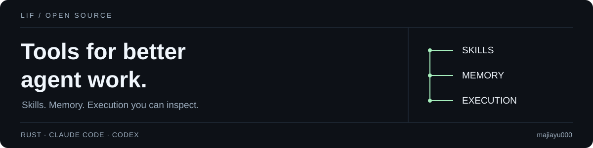
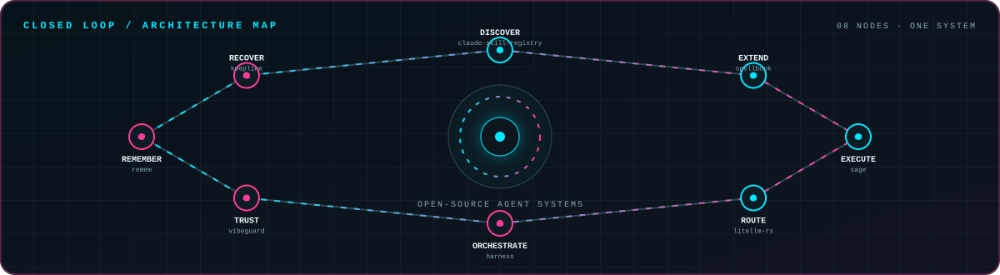

<picture>
  <source media="(prefers-color-scheme: dark)" srcset="./assets/hero-dark.svg">
  <source media="(prefers-color-scheme: light)" srcset="./assets/hero-light.svg">
  
</picture>

I build native systems around coding agents: **workbenches, skills, deterministic verification, memory, routing, and forensics.** 
Each project works alone. Together, they form a closed execution loop.

---

### `// START_WITH_A_TASK`

Choose the problem you want to solve, then follow that project's setup guide.

| Your task | Start here |
|:--|:--|
| Run parallel coding agents in one native macOS workbench | [fibo](https://github.com/majiayu000/fibo#readme) ([fibo.page](https://fibo.page)) |
| Find, reuse, and audit skills for coding agents | [claude-skill-registry](https://github.com/majiayu000/claude-skill-registry#readme) for discovery · [spellbook](https://github.com/majiayu000/spellbook#readme) for workflows · [skill-checkup](https://github.com/majiayu000/skill-checkup#readme) to lint installed skills |
| Stop unverified completions and guard agent changes | [vibeguard](https://github.com/majiayu000/vibeguard#readme) · [receipt](https://github.com/majiayu000/receipt#readme) |
| Keep context across long-running agent work | [remem](https://github.com/majiayu000/remem#readme) |
| Route requests across 60+ LLM providers in Rust | [litellm-rs](https://github.com/majiayu000/litellm-rs#readme) |
| Track Claude, Codex, Cursor, and Grok quotas & costs | [quotabar](https://github.com/majiayu000/quotabar#readme) · [ccstats](https://github.com/majiayu000/ccstats#readme) |
| Inspect Claude routing consistency and local alerts | [claude-route-watch](https://github.com/majiayu000/claude-route-watch#readme) |

Each repository documents its own installation, requirements, support, and license.
The stack diagram below describes how the projects relate; it is not a shared installer.

---

### `// THE_CLOSED_LOOP`

<picture>
  <source media="(prefers-color-scheme: dark)" srcset="./assets/closed-loop-dark.svg">
  <source media="(prefers-color-scheme: light)" srcset="./assets/closed-loop-light.svg">
  
</picture>

---

### `// FLAGSHIP_SYSTEMS`

<table>
  <tr>
    <td width="33%" valign="top">
      <code>WORKBENCH / 01</code>
      <h3><a href="https://github.com/majiayu000/fibo">fibo</a></h3>
      
Native macOS workbench for coding agents (GPUI + libghostty): persistent daemon, live attention states, never lose a session.

      
    </td>
    <td width="33%" valign="top">
      <code>EXTEND / 02</code>
      <h3><a href="https://github.com/majiayu000/claude-skill-registry">claude-skill-registry</a></h3>
      
Searchable discovery catalog for Claude Code &amp; agent skills, paired with <a href="https://github.com/majiayu000/spellbook">spellbook</a> workflows.

      
    </td>
    <td width="33%" valign="top">
      <code>ROUTE / 03</code>
      <h3><a href="https://github.com/majiayu000/litellm-rs">litellm-rs</a></h3>
      
High-performance Rust LLM gateway with 60+ runtime-wired providers through one OpenAI-compatible contract.

      
      
    </td>
  </tr>
  <tr>
    <td width="33%" valign="top">
      <code>ORCHESTRATE / 04</code>
      <h3><a href="https://github.com/majiayu000/harness">harness</a></h3>
      
Governed fleets of parallel coding agents, powered by a Rust control plane.

      
    </td>
    <td width="33%" valign="top">
      <code>TRUST / 05</code>
      <h3><a href="https://github.com/majiayu000/vibeguard">vibeguard</a></h3>
      
Scoped review rules, native Bash/Git hooks, and guardrails against unverified agent changes.

      
    </td>
    <td width="33%" valign="top">
      <code>REMEMBER / 06</code>
      <h3><a href="https://github.com/majiayu000/remem">remem</a></h3>
      
Local-first, SQLCipher-encrypted memory for long-running Claude Code and Codex work.

      
    </td>
  </tr>
</table>

<b><code>// OPEN_MODULE_BAY</code></b> — Rust crates, verification probes, and agent skills

 

#### Rust crates & native engines

| Project | Role |
|:--|:--|
| [`jsonrepair-rs`](https://github.com/majiayu000/jsonrepair-rs) | Repair 30+ classes of malformed JSON from LLM outputs (150k+ downloads on crates.io) |
| [`agent-sessions`](https://github.com/majiayu000/agent-sessions) | Streaming Rust parsers with byte-offset provenance across 25+ local coding-agent formats |
| [`markitdown-rs`](https://github.com/majiayu000/markitdown-rs) | 4.5 MB Rust rewrite of `markitdown` (401/406 byte-identical, median 408× faster CLI + MCP server) |
| [`ingot`](https://github.com/majiayu000/ingot) | Native Rust + custom Metal MoE inference engine for Apple Silicon |
| [`rekey`](https://github.com/majiayu000/rekey) | Local Credential Authority for AI agents backed by macOS Secure Enclave |
| [`rnk`](https://github.com/majiayu000/rnk) | Declarative Rust TUI framework with React-like hooks and 45+ components |
| [`palim`](https://github.com/majiayu000/palim) | Reversible JSON diff, RFC 6902 Patch, and RFC 7396 Merge Patch in Rust |
| [`ccstats`](https://github.com/majiayu000/ccstats) | Local-first token and cost analytics engine across AI coding agents |

#### Verification, security & empirical forensics

| Project | Role |
|:--|:--|
| [`receipt`](https://github.com/majiayu000/receipt) | Deterministic Stop hook blocking hallucinated `"tests pass"` / `"committed"` claims without proof |
| [`paperdiff`](https://github.com/majiayu000/paperdiff) | Line-by-line arXiv paper vs. GitHub code hyperparameter & seed consistency checker |
| [`stealthprint`](https://github.com/majiayu000/stealthprint) | Fingerprint anonymous or proxied LLMs via tokenizer, wrapper, context, and vision probes |
| [`keyspoor`](https://github.com/majiayu000/keyspoor) | Offline secret scanning across Git hooks, CI, and read-only MCP |
| [`argus`](https://github.com/majiayu000/argus) | Static supply-chain admission scanner across eight package ecosystems and lockfiles |
| [`verdict`](https://github.com/majiayu000/verdict) | Pin agent skill capability contracts to catch post-install drift and runtime overreach |
| [`mcp-mux`](https://github.com/majiayu000/mcp-mux) | Multi-account OAuth multiplexer for any MCP server backed by macOS Keychain |

#### Skills, catalogs & desktop companions

| Project | Role |
|:--|:--|
| [`spellbook`](https://github.com/majiayu000/spellbook) | Cross-runtime workflow skills for Claude Code, Codex, and multi-agent pipelines |
| [`skill-checkup`](https://github.com/majiayu000/skill-checkup) | Audit installed `SKILL.md` folders for drift, broken references, and description gaps |
| [`quotabar`](https://github.com/majiayu000/quotabar) | Menu bar quota window, reset pace, and subscription value monitor for Claude, Codex, Cursor & Grok |
| [`dsh-desk`](https://github.com/majiayu000/dsh-desk) | Bundled desktop distribution for DeepSeek Harness with daily compatibility checks |
| [`awesome-grok-bot`](https://github.com/majiayu000/awesome-grok-bot) | Curated, shelf-tiered catalog of 6,600+ live Grok Bot shares |
| [`awesome-goal-prompts`](https://github.com/majiayu000/awesome-goal-prompts) | Source-backed `/goal` contracts for long-running autonomous coding sessions |
| [`peerscope`](https://github.com/majiayu000/peerscope) · [`you-are-here`](https://github.com/majiayu000/you-are-here) · [`agent-patterns`](https://github.com/majiayu000/agent-patterns) · [`patch-tournament`](https://github.com/majiayu000/patch-tournament) · [`shipwise`](https://github.com/majiayu000/shipwise) | Focused skills for competitive teardowns, overnight handoff maps, patch grading, and open-source launches |

---

### `// OPEN_CHANNEL`

BEIJING · UTC+8 · USUALLY BUILDING SOMETHING THAT KEEPS AGENTS HONEST

